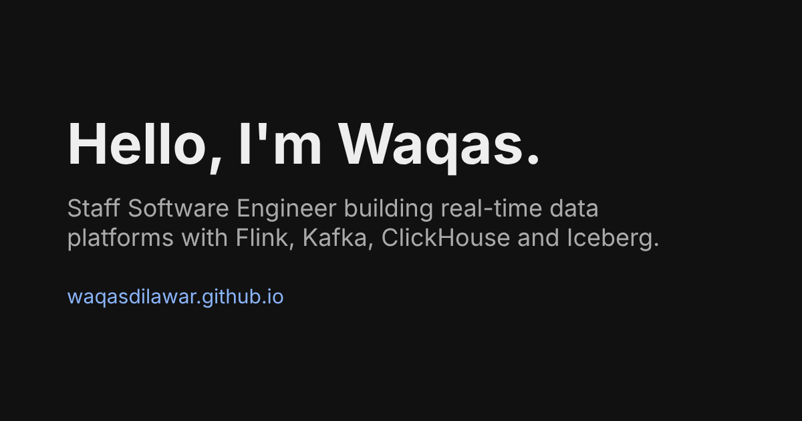

### Hi there 👋

I'm Waqas, a Staff Software Engineer in Lahore, Pakistan. I build real-time data platforms with Apache Flink, Kafka, ClickHouse and Apache Iceberg, on Java and Spring Boot. I like teaching, and I hope one of my videos or repos helps you solve a problem or learn something new.

Currently Staff Software Engineer at [Unifonic](https://www.unifonic.com/). Previously [Contour Software](https://contour-software.com/) and [Moftak Solutions](https://moftak.com/).

### 🤝 Connect with me

- Website: https://waqasdilawar.github.io
- YouTube: [Learn with Waqas Dilawar](https://www.youtube.com/@learnwithwaqasdilawar4529)
- LinkedIn: [Waqas Dilawar](https://www.linkedin.com/in/muhammad-waqas-dilawar-a721b8105/)
- X: [@waqasdaha](https://x.com/waqasdaha)
- Bluesky: [waqasdaha.bsky.social](https://bsky.app/profile/waqasdaha.bsky.social)
- Stack Overflow: [Muhammad Waqas Dilawar](https://stackoverflow.com/users/6332074/muhammad-waqas-dilawar)

### 🖥 Latest YouTube videos

<!-- YOUTUBE:START -->
<!-- YOUTUBE:END -->
